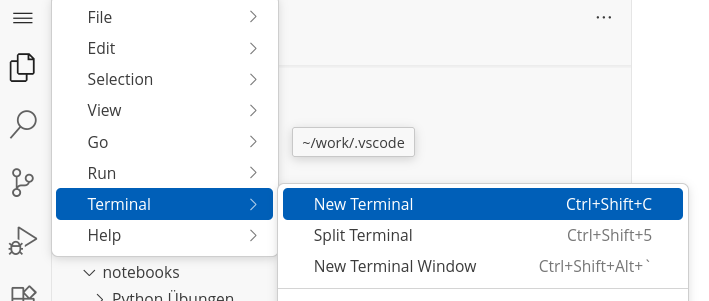
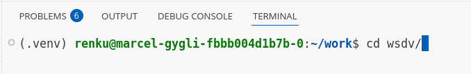
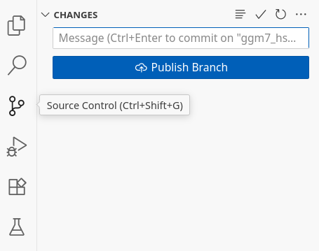
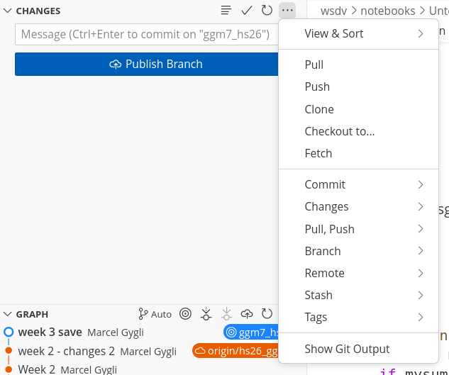
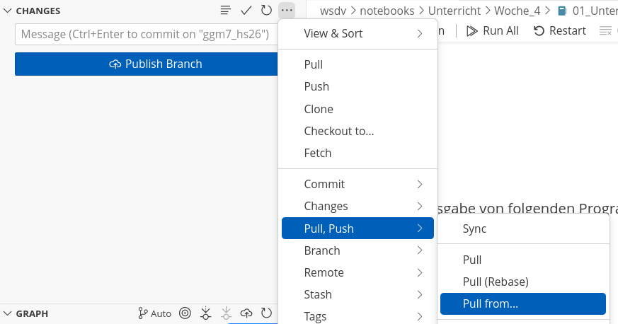
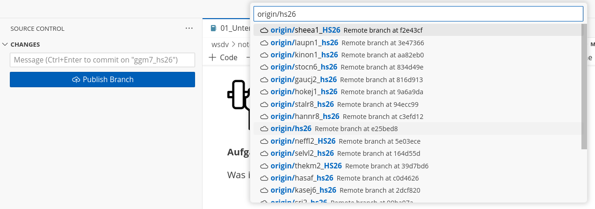

# Pullen eines Branches auf Renkulab

Um Änderungen von den Dozierenden in eure Arbeitsumgebung zu laden könnt ihr folgendermassen vorgehen:

1. Neustarten der Session

2. Öffnen des Terminals in Renku

3. Navigieren in den korrekten ordner mit dem Befehl "cd wsdv"

4. Eingeben des Befehls "git config pull.rebase false"

5. Öffnen des Source Control Tabs

6. Klicken auf "..." rechts bei "Changes"

7. Auswählen von "Pull, Push" --> "Pull from"

8. Eingeben von "origin/hs26" (Achtung auf korrekte schreibweise achten!)

    