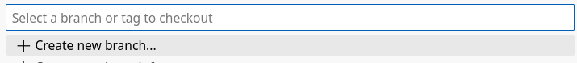
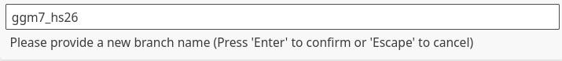
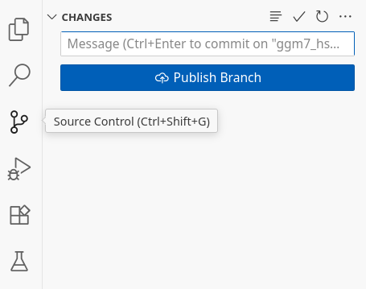

# Erstellen eines persönlichen Branches für das Speichern auf Renkulab

Für das saubere speichern müsst ihr einen eigenen Branch auf Renkulab / Gitlab anlegen.
Dazu geht ihr in Renkulab folgendermassen vor:

1. Clicken auf den aktuellen Branchnamen im Footer-Menü (unten links)
   

2. Erstellen eines neuen Branches mit click auf "+ Create new branch"
   

3. Definieren eines neuen Branch-Namens mit KÜRZEL_HS26 (z.b. ggm7_hs26)
   

4. Überprüfen, dass der Branch automatisch selektiert wurde. Sollte jetzt um Footer-Menü entsprechend angezeigt werden.
   

5. Wechseln im Menü auf der linken Seite zu "Source Control"
   

6. Publizieren des Branches mit "Publish Branch"

Danach könnt solltet ihr ohne weiteres Änderungen auf diesem Branch sichern können.